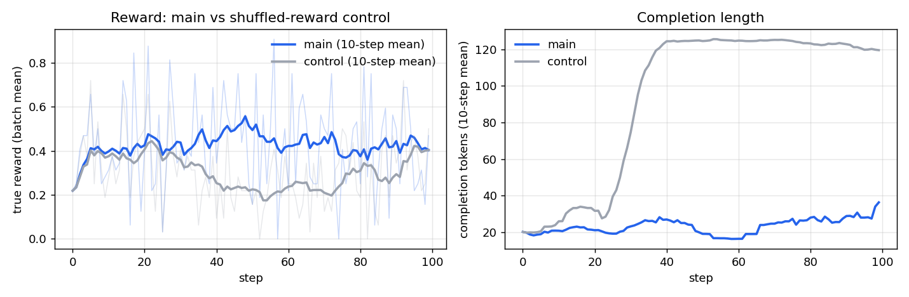

# Run analysis (generated by analyze.py from raw outputs)

## Part 3: held-out Countdown-3, greedy, 500 items

| arm | pass (all) | pass +/- | pass */÷ | has `<answer>` | truncated | mean len |
|---|---|---|---|---|---|---|
| base | 0.318 | 0.392 | 0.129 | 1.000 | 0.020 | 19.1 |
| adapter | 0.430 | 0.583 | 0.036 | 1.000 | 0.108 | 34.4 |
| control | 0.404 | 0.553 | 0.021 | 0.442 | 0.558 | 119.4 |
| merged | 0.502 | 0.681 | 0.043 | 1.000 | 0.042 | 23.2 |
| random_adapter | 0.320 | 0.394 | 0.129 | 1.000 | 0.016 | 18.8 |
| random_merged | 0.320 | 0.394 | 0.129 | 1.000 | 0.018 | 19.1 |

Items: 360 +/- only, 140 need * or /.

Paired differences (bootstrap 95 % CI over items, 4000 resamples):

| pair | subset | n | diff | 95 % CI | a better | b better |
|---|---|---|---|---|---|---|
| adapter − base | all | 500 | +0.112 | [+0.060, +0.162] | 121 | 65 |
| adapter − base | +/- only | 360 | +0.192 | [+0.125, +0.258] | 116 | 47 |
| adapter − base | needs * or / | 140 | -0.093 | [-0.157, -0.029] | 5 | 18 |
| adapter − control | all | 500 | +0.026 | [-0.018, +0.070] | 70 | 57 |
| adapter − control | +/- only | 360 | +0.031 | [-0.028, +0.092] | 66 | 55 |
| adapter − control | needs * or / | 140 | +0.014 | [-0.021, +0.050] | 4 | 2 |
| control − base | all | 500 | +0.086 | [+0.036, +0.134] | 102 | 59 |
| control − base | +/- only | 360 | +0.161 | [+0.100, +0.222] | 99 | 41 |
| control − base | needs * or / | 140 | -0.107 | [-0.171, -0.043] | 3 | 18 |
| merged − adapter | all | 500 | +0.072 | [+0.040, +0.104] | 52 | 16 |
| merged − adapter | +/- only | 360 | +0.097 | [+0.056, +0.139] | 48 | 13 |
| merged − adapter | needs * or / | 140 | +0.007 | [-0.029, +0.043] | 4 | 3 |
| merged − base | all | 500 | +0.184 | [+0.136, +0.230] | 128 | 36 |
| merged − base | +/- only | 360 | +0.289 | [+0.231, +0.344] | 126 | 22 |
| merged − base | needs * or / | 140 | -0.086 | [-0.143, -0.036] | 2 | 14 |
| random_adapter − base | all | 500 | +0.002 | [-0.010, +0.014] | 5 | 4 |
| random_adapter − base | +/- only | 360 | +0.003 | [-0.014, +0.019] | 5 | 4 |
| random_adapter − base | needs * or / | 140 | +0.000 | [+0.000, +0.000] | 0 | 0 |
| random_merged − random_adapter | all | 500 | +0.000 | [-0.008, +0.008] | 2 | 2 |
| random_merged − random_adapter | +/- only | 360 | +0.000 | [-0.011, +0.011] | 2 | 2 |
| random_merged − random_adapter | needs * or / | 140 | +0.000 | [+0.000, +0.000] | 0 | 0 |
| random_merged − base | all | 500 | +0.002 | [-0.008, +0.012] | 4 | 3 |
| random_merged − base | +/- only | 360 | +0.003 | [-0.011, +0.017] | 4 | 3 |
| random_merged − base | needs * or / | 140 | +0.000 | [+0.000, +0.000] | 0 | 0 |

Correct given an `<answer>` was produced (format separated from correctness):

- base: 0.318 of 500 answered
- adapter: 0.430 of 500 answered
- control: 0.914 of 221 answered
- merged: 0.502 of 500 answered
- random_adapter: 0.320 of 500 answered
- random_merged: 0.320 of 500 answered

Adapter output text identical to base on 78/500 items; 121 items fixed, 65 broken.
Control output text identical to base on 0/500 items.
  - `countdown3-heldout-0` base: `<answer>14 + 62 - 2</answer>` → adapter: `<answer>62 + 14 + 2</answer>`
  - `countdown3-heldout-106` base: `<answer>49 + 21 - 6</answer>` → adapter: `<answer>49 + 21 + 6</answer>`
  - `countdown3-heldout-118` base: `<answer>85 + (90 - 81) / 9</answer>` → adapter: `<answer>90 - (85 - 81)</answer>`

Greedy output text identical (fraction of items):

| | base | adapter | control | merged | random_adapter | random_merged |
|---|---|---|---|---|---|---|
| base | 1.00 | 0.16 | 0.00 | 0.26 | 0.94 | 0.94 |
| adapter | 0.16 | 1.00 | 0.00 | 0.65 | 0.15 | 0.15 |
| control | 0.00 | 0.00 | 1.00 | 0.00 | 0.00 | 0.00 |
| merged | 0.26 | 0.65 | 0.00 | 1.00 | 0.26 | 0.26 |
| random_adapter | 0.94 | 0.15 | 0.00 | 0.26 | 1.00 | 0.94 |
| random_merged | 0.94 | 0.15 | 0.00 | 0.26 | 0.94 | 1.00 |

Rescored on the FIRST `<answer>` (the training reward takes the last one):

| arm | >1 `<answer>` tag | pass, last tag (reward) | pass, first tag |
|---|---|---|---|
| base | 0.016 | 0.318 | 0.316 |
| adapter | 0.180 | 0.430 | 0.370 |
| control | 0.000 | 0.404 | 0.404 |
| merged | 0.070 | 0.502 | 0.488 |
| random_adapter | 0.014 | 0.320 | 0.316 |
| random_merged | 0.016 | 0.320 | 0.316 |
- first tag, adapter − base: +0.054 [+0.000, +0.108]
- first tag, adapter − control: -0.034 [-0.080, +0.012]
- first tag, merged − base: +0.172 [+0.124, +0.220]
- first tag, random_adapter − base: +0.000 [-0.010, +0.010]

Rescored with ÷ × − mapped to / * - (the reward scores them 0; arithmetic apart from spelling):

| arm | answers rescued | pass (all) | pass +/- | pass */÷ |
|---|---|---|---|---|
| base | 0 | 0.318 | 0.392 | 0.129 |
| adapter | 1 | 0.432 | 0.583 | 0.043 |
| control | 12 | 0.428 | 0.553 | 0.107 |
| merged | 0 | 0.502 | 0.681 | 0.043 |
| random_adapter | 0 | 0.320 | 0.394 | 0.129 |
| random_merged | 0 | 0.320 | 0.394 | 0.129 |

- normalised, adapter − base, all: +0.114 [+0.060, +0.164]
- normalised, adapter − base, needs * or /: -0.086 [-0.157, -0.021]
- normalised, adapter − control, all: +0.004 [-0.042, +0.048]
- normalised, adapter − control, needs * or /: -0.064 [-0.114, -0.014]
- normalised, control − base, all: +0.110 [+0.060, +0.158]
- normalised, control − base, needs * or /: -0.021 [-0.086, +0.043]
- normalised, merged − adapter, all: +0.070 [+0.038, +0.102]
- normalised, merged − adapter, needs * or /: +0.000 [-0.043, +0.036]

Share of final answers that use * or / (after normalising ÷ ×), among items with an answer:

| arm | +/- items | */÷ items |
|---|---|---|
| base | 0.15 (of 360) | 0.37 (of 140) |
| adapter | 0.01 (of 360) | 0.13 (of 140) |
| control | 0.00 (of 201) | 0.75 (of 20) |
| merged | 0.01 (of 360) | 0.14 (of 140) |
| random_adapter | 0.14 (of 360) | 0.37 (of 140) |
| random_merged | 0.15 (of 360) | 0.37 (of 140) |

verify.py rules: `{'R1_effect': True, 'R2_not_generic': False, 'R3_merge': False, 'R4_not_format': True}` → **NOT SHOWN: R2_not_generic, R3_merge**
Merged vs adapter text identical: 0.648

## Training curves (true reward; the control trains on shuffled rewards but logs the true ones)

| run | steps | true reward, first 20 | last 20 | zero-var groups | grad norm | ‖ΔW‖ (LoRA, fro) |
|---|---|---|---|---|---|---|
| main | 100 | 0.402 | 0.411 | 0.72 | 1.25 | 0.997 |
| control | 100 | 0.377 | 0.341 | 0.14 | 0.43 | 0.847 |

Main run: 400 unique prompts of 400 used (each once), so the true reward per step is a T = 1 score on unseen prompts. Last 25 − first 25 steps: -0.004 [-0.114, +0.104] (bootstrap over steps). Zero-variance groups rose from 0.56 (first 20 steps) to 0.79 (last 20).

## Part 1: measured (main run) vs predicted (task1_budget/results/countdown_measured_hw.md)

| quantity | predicted | measured |
|---|---|---|
| step time | 22.2 s (decode to C = 128 every step) | mean 20.1 s, median 26.7 s |
| generation share | 76 % | 55 % |
| decode passes / step | 128 | mean 75.6, max 127 (stops when every sequence ends) |
| decode time per pass | 16.38 s / 128 = 128 ms (PCIe-bound, 11 streamed layers × 7.9 ms) | 128 ms |
| prefill | 0.56 s | 1.26 s |
| train (fwd + bwd) | 5.3 s | 9.1 s |
| GPU peak, nvidia-smi (device-wide) | 7603 MiB at 25 resident (24 used: −193) | 7793 MiB of 7840 visible |
| allocated peak rollout / train | — | 7232 / 6437 MiB |
| reserved peak | — | 7542 MiB |
| host RSS peak | 10.05 GiB | 5.27 GiB |
| allocator retries / OOMs over the run | 0 | 0 / 0 |
| rollout: H2D GB/s, copy hidden behind compute | 25.5 GB/s | 25.5 GB/s, 35 % hidden (copy 7270 ms, stall 4723 ms) |
| train: H2D GB/s, copy hidden behind compute | 25.5 GB/s | 24.9 GB/s, 97 % hidden (copy 194 ms, stall 6 ms) |

On-policy check: |logp at rollout − logp at training| per token, mean 0.0078, max 1.646 nats.

## Part 2b: kill/resume on the GPU (SIGKILL after step 3 train, step 6 rollout, step 8 checkpoint)

- attempts: ['start', 'resume', 'resume', 'resume']
- sample ledger of 10 steps identical to the uninterrupted main run: **True**; duplicates 0; steps contiguous True
- rollout tokens identical to main per step: [True, True, True, True, True, True, True, True, True, True]
- rewards identical per step: [True, True, True, True, True, True, True, True, True, True]
